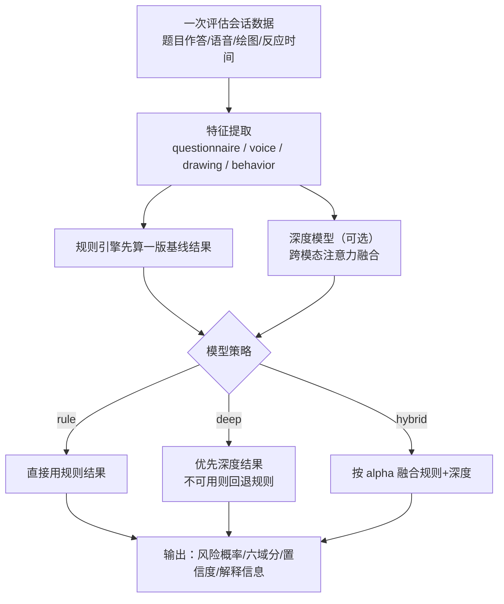

# 多模态白话说明（小白版）

> 适用对象：第一次接触“多模态模型”的同学  
> 目标：5~10 分钟读完后，能看懂本项目的输入、推理、输出和 4x4 注意力矩阵

---

## 1. 一句话先说清楚：什么是“多模态”

你可以把“模态”理解成“不同来源的信息”。

在本项目当前实现里，模型会同时看 4 类信息（4 个模态）：

1. `questionnaire`：量表/题目作答统计特征  
2. `voice`：语音相关统计特征（字数、时长、停顿等）  
3. `drawing`：绘图相关统计特征（笔画、点数、结构等）  
4. `behavior`：行为反应特征（反应时间均值/波动/快慢比例等）

模型不是“只看一道题对不对”，而是把这 4 路信息综合起来判断风险。

---

## 2. 先澄清一个容易混淆的点

你在文档里看到过“视频、图片、时间轴重采样”等描述，这是总体设计方向；  
**当前后端主链路**落地的是上面 4 个“统计特征模态”。

也就是说，当前深度模型吃进去的是数值特征向量，不是原始 mp4 帧序列直接端到端喂入。

---

## 3. 整体流程图（从作答到结果）



---

## 4. 深度模型内部到底做了什么（白话）

可以按 6 步理解：

1. **四模态各自编码**：把四路输入先变成同一“语言”（同维度向量）。  
2. **跨模态注意力**：让每个模态都“看看另外三个模态”，判断谁更值得参考。  
3. **风险分类头**：输出 `NC / MCI / AD` 三类概率。  
4. **认知域回归头**：输出 6 个认知域分数（`0~10`）。  
5. **模态贡献头**：输出每个模态贡献占比（百分比）。  
6. **注意力矩阵**：输出 `4x4`，用于解释“谁在关注谁”。

---

## 5. 输出字段示例（你在接口里会看到什么）

下面是一个简化后的示例（结构与真实返回一致）：

```json
{
  "model_name": "hybrid_rule_deep_fusion",
  "model_strategy": "hybrid",
  "nc_probability": 0.2214,
  "mci_probability": 0.5632,
  "ad_probability": 0.2154,
  "domain_scores": {
    "memory": 4.92,
    "orientation": 6.35,
    "language": 5.41,
    "attention": 5.12,
    "visuospatial": 4.88,
    "executive": 4.73
  },
  "model_confidence": 0.7821,
  "modality_quality": {
    "questionnaire": 0.83,
    "voice": 0.71,
    "drawing": 0.66,
    "behavior": 0.74
  },
  "modality_contributions": {
    "questionnaire": 24.56,
    "voice": 31.44,
    "drawing": 18.83,
    "behavior": 25.17
  },
  "attention_matrix": [
    [0.42, 0.25, 0.13, 0.20],
    [0.21, 0.40, 0.17, 0.22],
    [0.16, 0.23, 0.45, 0.16],
    [0.18, 0.28, 0.14, 0.40]
  ],
  "engine_info": {
    "engine": "deep_cross_modal",
    "checkpoint_loaded": true,
    "device": "cpu"
  }
}
```

---

## 6. 怎么解读 4x4 注意力矩阵（重点）

### 6.1 先记住行列顺序

本项目固定顺序是：

1. `questionnaire`
2. `voice`
3. `drawing`
4. `behavior`

所以矩阵中：

- 第 1 行 = `questionnaire` 在看谁  
- 第 2 行 = `voice` 在看谁  
- 第 3 行 = `drawing` 在看谁  
- 第 4 行 = `behavior` 在看谁

### 6.2 每一行都可以当“权重分配”

以示例第 2 行 `[0.21, 0.40, 0.17, 0.22]` 为例：

- `voice -> questionnaire`：0.21  
- `voice -> voice`：0.40  
- `voice -> drawing`：0.17  
- `voice -> behavior`：0.22

解释：语音模态在融合时，最依赖自己（0.40），其次也参考行为和量表。

### 6.3 对角线的意义

对角线位置（`[1,1] [2,2] [3,3] [4,4]`）代表“看自己”。

- 对角线高：该模态更依赖自身信息  
- 非对角高：跨模态依赖更强（例如语音更依赖行为）

### 6.4 重要提醒

注意力矩阵是“模型内部信息流权重”，不是医学因果结论。  
它适合做可解释辅助，不等于“某模态导致疾病”。

---

## 7. `rule / deep / hybrid` 三种策略怎么选

1. `rule`：只走规则，最稳。  
2. `deep`：只走深度，模型不可用会回退。  
3. `hybrid`：规则+深度按权重融合（默认推荐）。

如果你只是想先稳定跑通业务，建议先 `rule`；  
要提升表达和效果演示，建议用 `hybrid`。

---

## 8. 常见问题（小白高频）

### Q1：我只有量表，没有语音/绘图，会不会崩？

不会。系统对缺失模态有兜底，会降低质量评分并尽量给出结果。

### Q2：模态贡献度是不是越高越“有问题”？

不一定。它表示“这次判定里这个模态影响更大”，不是“问题更严重”。

### Q3：为什么有时会看到 deep 回退？

常见原因：

1. 没安装 `torch`  
2. checkpoint 不存在或不可读  

可在 `engine_info` 里看具体原因字段。

---

## 9. 给第一次看结果页的同学一个阅读顺序

建议按这个顺序看：

1. 先看 `nc/mci/ad` 概率（总体风险）  
2. 再看六认知域分数（哪里薄弱）  
3. 再看 `model_confidence`（结果可靠性）  
4. 再看 `modality_quality`（数据质量）  
5. 最后看 `attention_matrix` 和 `top_factors`（解释信息）

这样最不容易被复杂字段劝退。

