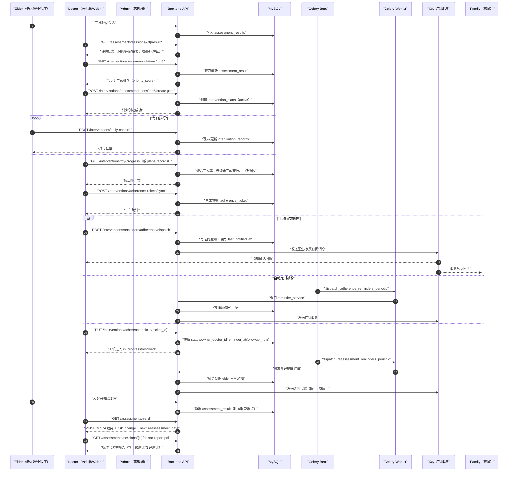

# 医生端干预闭环时序图（评估结果 → 计划 → 打卡 → 预警 → 复评）

## 1. 目标
本文档描述医生端“认知评估后干预闭环”的完整时序，覆盖：
- 评估结果读取与 Top-5 推荐
- 一键生成干预计划
- 老人每日打卡与依从性跟踪
- 低依从预警工单与提醒触达（医生/家属）
- 复评提醒、复评完成、趋势与报告更新

## 2. 业务时序图（Mermaid）

## 3. 关键状态与闭环判定
- 计划状态：`active / paused / completed / cancelled`
- 工单状态：`open / in_progress / resolved / ignored`
- 闭环达成最小条件：
  - 已生成干预计划（`intervention_plans`）
  - 有连续打卡记录（`intervention_records`）
  - 低依从工单已被处置（`resolved` 或 `ignored`，含回访记录）
  - 已进入下一次复评周期并生成趋势点

## 4. 对应核心接口（按阶段）
- 结果与推荐：
  - `GET /api/v1/assessments/sessions/{session_id}/result`
  - `GET /api/v1/interventions/recommendations/top5`
- 建计划：
  - `POST /api/v1/interventions/recommendations/top5/create-plan`
  - `POST /api/v1/interventions/plans`（手动创建）
- 执行与进度：
  - `POST /api/v1/interventions/daily-checkin`
  - `GET /api/v1/interventions/my-progress`
  - `GET /api/v1/interventions/plans/{plan_id}/records`
- 预警工单：
  - `POST /api/v1/interventions/adherence-tickets/sync`
  - `GET /api/v1/interventions/adherence-tickets`
  - `PUT /api/v1/interventions/adherence-tickets/{ticket_id}`
- 提醒触达：
  - `POST /api/v1/interventions/reminders/adherence/dispatch`
  - `POST /api/v1/assessments/reminders/reassessment/dispatch`
  - `POST /api/v1/users/wechat-bindings/by-code`
- 复评与报告：
  - `GET /api/v1/assessments/trend`
  - `GET /api/v1/assessments/sessions/{session_id}/doctor-report.pdf`
  - `GET /api/v1/assessments/sessions/{session_id}/family-report`

## 5. 当前实现说明
- 支持“手动派发 + Celery Beat 自动派发”双路径提醒。
- 医生工作台已支持从队列跳转到目标页进行筛选与处置。
- 微信链路支持 `wx.login code -> openid` 绑定；是否真实发送取决于生产微信配置与 `WECHAT_MOCK_MODE`。
